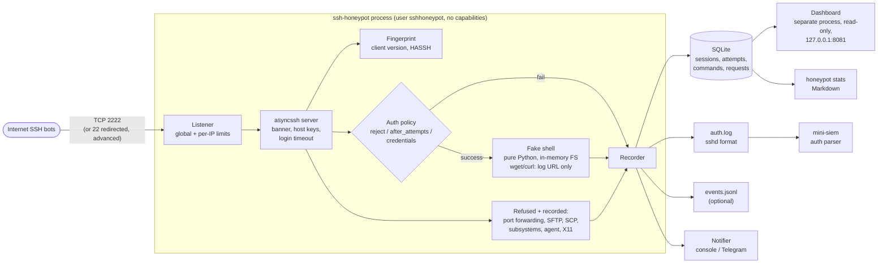

# ssh-honeypot

🇹🇷 [Türkçe](README.tr.md)

[](https://github.com/rosko35/ssh-honeypot/actions/workflows/ci.yml)


A low-interaction SSH honeypot. It listens on a spare port, looks like an
ordinary Ubuntu OpenSSH server, and records what internet-wide SSH bots do:
every username and password they try, the public keys they offer, their
client version and HASSH fingerprint, and - if you let them "log in" - every
command they type into a **completely simulated** shell. Data goes to SQLite,
an sshd-style `auth.log` (which [mini-siem](https://github.com/rosko35/mini-siem)
can tail) and optionally a JSON-lines log. A small read-only dashboard and a
`honeypot stats` command turn it into charts and README tables.

It is built to be the least dangerous thing on the server: the attacker never
reaches a real shell, nothing is executed or downloaded, the process has no
privileges and every connection is bounded in time, size and number.

> **Thinking of running it on the same VPS as your website or mail?**
> Read [Should you run this next to production?](#should-you-run-this-next-to-production)
> first. Short version: it is designed for that, but a separate cheap VPS is
> still the better choice.

<!-- DEMO: replace with a real recording, e.g. docs/demo.gif (a bot session replayed in the dashboard) -->
> **Demo GIF placeholder** - `docs/demo.gif`: an SSH session against the fake shell and its transcript appearing in the dashboard.

<!-- SCREENSHOT: replace with docs/dashboard.png -->
> **Screenshot placeholder** - `docs/dashboard.png`: dashboard with attempts over time, top credentials, sources and a session transcript.

<!-- SCREENSHOT: replace with docs/telegram.png -->
> **Screenshot placeholder** - `docs/telegram.png`: a Telegram notification for a session that reached the fake shell.

---

## Features

- **Realistic SSH front door** - [asyncssh](https://asyncssh.readthedocs.io/)
  server with a configurable OpenSSH banner (`SSH-2.0-OpenSSH_9.6p1
  Ubuntu-3ubuntu13.5` by default) and persistent ed25519 / ECDSA / RSA host
  keys generated on first start.
- **Records every attempt** - timestamp, source IP and port, username,
  password, offered public-key type and SHA256 fingerprint, client version
  string, negotiated key exchange and cipher, and the
  [HASSH](https://github.com/salesforce/hassh) fingerprint of the client's
  algorithm lists.
- **Three authentication policies** - `reject` (default: pure credential
  harvesting), `after_attempts` (the Nth password from one IP "works") and
  `credentials` (a list of weak username/password pairs, `*` wildcards).
- **Fake shell** - a pure-Python, in-memory imitation of an Ubuntu 24.04 box:
  `uname`, `id`, `ls`, `cat`, `cd`, `ps`, `w`, `free`, `df`, pipes into
  `grep | head | wc | awk`, redirections into an in-memory filesystem
  (`echo key >> ~/.ssh/authorized_keys` works and is recorded), `sh -c`,
  busybox applet probes. Unknown commands print `command not found`.
  `wget`, `curl` and `tftp` **only log the URL** and print a resolver error.
- **Records the session** - every command line with its offset from the
  connection start, exec requests, and refused port-forwarding, SFTP,
  subsystem, agent and X11 requests.
- **Bounded by design** - global and per-IP concurrent connection limits,
  login timeout, idle timeout, maximum session duration, maximum input bytes,
  commands, channels, line length and queued output per connection.
- **Storage** in SQLite (WAL), plus an sshd-compatible `auth.log` with a
  distinct hostname, and an optional JSON-lines event log. Both text logs
  rotate themselves by size.
- **`honeypot stats`** prints README-ready Markdown: totals, top usernames,
  passwords and pairs, masked source networks, countries (with a GeoIP
  database), client versions, HASSH and the most common first commands.
- **Dashboard** (FastAPI + Chart.js): attempts over time, top credentials,
  sources, countries, client versions, download URLs and recent sessions with
  their command transcript. Read-only, `127.0.0.1` only, optional basic auth,
  strict CSP with Subresource Integrity.
- **Telegram notification** (optional, batched and rate-limited) when a
  session reaches the fake shell.
- **Deployment** - hardened systemd units and an install script in the same
  style as mini-siem, or Docker with a read-only, capability-free container.

## Architecture



The internet-facing process contains no web server; the dashboard is a
separate process that opens the database read-only. Everything the attacker
can influence flows in one direction: from the socket into the recorder.

## Quick start (local, loopback only)

```bash
python -m venv .venv && source .venv/bin/activate     # Windows: .venv\Scripts\activate
pip install -e ".[dev]"

honeypot run                    # 127.0.0.1:2222, policy "reject"
```

In another terminal:

```bash
ssh -p 2222 -o StrictHostKeyChecking=no -o UserKnownHostsFile=/dev/null root@127.0.0.1
# every password fails - and is recorded

honeypot stats --days 1 --min-sources 1     # Markdown summary
honeypot dashboard                          # http://127.0.0.1:8081
```

To try the fake shell, copy the config and change the policy:

```bash
cp config.yml config.local.yml
# in config.local.yml:  auth: {policy: after_attempts, accept_after: 2}
honeypot -c config.local.yml run
```

The shipped `config.yml` listens on `127.0.0.1` on purpose: running the
project from a checkout never exposes anything. The install script and the
Docker image switch it to all interfaces for deployment.

## Running it on a server

See **[DEPLOY.md](DEPLOY.md)** for the step-by-step guide (systemd or
Docker), the two ways to expose the port and their risks, the optional egress
firewall rule, and how to connect mini-siem. In short:

```bash
git clone https://github.com/rosko35/ssh-honeypot.git && cd ssh-honeypot
sudo ./deploy/install.sh            # installs, does not start
sudo systemctl enable --now ssh-honeypot
sudo ufw allow 2222/tcp             # your decision, see DEPLOY.md
```

## Authentication policies

| `auth.policy` | What happens | Use it for |
|---|---|---|
| `reject` (default) | every password and key fails | credential statistics; smallest attack surface |
| `after_attempts` | the `accept_after`-th password attempt from one IP succeeds (counted across connections, in memory); the same credentials keep working for that IP | seeing what bots do after a "successful" brute force |
| `credentials` | only the listed pairs succeed, `*` matches anything | a classic weak-password trap (`root` / `123456`) |

Public keys are never accepted, only recorded. Usernames that are not in
`auth.valid_users` get sshd's `Invalid user` treatment in the auth log, as on
a real server. After `max_attempts_per_connection` failures the connection is
dropped, and every failure is answered after `failure_delay` seconds, like sshd.

## What gets recorded

| Table | One row per | Main columns |
|---|---|---|
| `sessions` | TCP connection | start/end, source IP/port, country, client version, HASSH + algorithm lists, kex, cipher, MAC, attempts, login user/password, terminal type, command count, bytes in, end reason |
| `auth_attempts` | password or key attempt | username, method, password, key type + SHA256 fingerprint, success |
| `commands` | command line (shell or exec) | time, seconds since connect, text, whether every command in it was known |
| `requests` | side request | exec, `direct-tcpip`, `tcpip-forward`, streamlocal, tun/tap, subsystem (e.g. `sftp`), with detail and accepted flag |
| `downloads` | URL given to wget/curl/tftp | tool, URL (never fetched) |

End reasons tell you how a connection finished: `client closed`, `idle
timeout`, `max duration`, `input limit`, `command limit`, `request limit`,
`too many auth attempts`, `output backlog` or `shutdown`.

## The fake shell and the safety model

The honeypot's most important property is what it does **not** do:

- It **never executes anything on the host**. There is no `subprocess`, no
  PTY, no real shell. Every command is a Python function that returns a
  string.
- It **never touches the real filesystem for attacker input**. The fake
  filesystem is a dictionary built from constants and copied per connection,
  with a byte and node budget (256 KB / 256 entries).
- It **never opens outbound connections on the attacker's behalf**. `wget`,
  `curl` and `tftp` record the URL and print a believable failure. Port
  forwarding, SFTP, SCP, subsystems, agent and X11 forwarding are refused.
  Reverse DNS and GSSAPI are disabled, so an incoming connection never causes
  an outgoing DNS query.
- `grep` matches fixed strings only, so an attacker cannot hand the honeypot
  a catastrophic regular expression.
- Every connection is bounded (defaults): 100 connections in total, 5 per IP,
  30 s to authenticate, 120 s idle, 600 s maximum, 64 KB of input, 200
  commands, 4 channels, 4096-character lines, 256 KB of unsent output, 100
  recorded side requests. Connections over the limit are dropped before any
  data is stored, so a flood cannot grow the database.

These properties are tested, not just promised: `tests/test_server.py`
drives the honeypot with a real SSH client and runs a TCP listener that must
receive **zero** connections while the client runs `wget`, `curl | sh` and
port forwarding against it; `tests/test_safety.py` parses the source of the
attacker-facing modules and fails if they import `subprocess`, `socket`,
`os`, `pathlib` and similar, call `open()`, or if the asyncssh options for
forwarding, SCP, SFTP and reverse DNS change.

## Pairing with mini-siem

[mini-siem](https://github.com/rosko35/mini-siem) is my log-based intrusion
detection system for the same kind of server. The honeypot writes
`/var/log/ssh-honeypot/auth.log` in exactly the format sshd uses:

```text
2026-11-19T10:15:01.123456+00:00 honeypot sshd[48213]: Invalid user admin from 198.51.100.7 port 50022
2026-11-19T10:15:01.130211+00:00 honeypot sshd[48213]: Failed password for invalid user admin from 198.51.100.7 port 50022 ssh2
2026-11-19T10:15:04.002871+00:00 honeypot sshd[48214]: Accepted password for root from 203.0.113.9 port 41234 ssh2
```

so mini-siem's existing `auth` parser reads it unchanged (a test feeds the
honeypot's own output through mini-siem's real parser). The hostname is
`honeypot` (configurable via `log_hostname`), so events are distinguishable
from the real sshd. Passwords are never written to this log, exactly like
sshd. Usernames are escaped (`\x20` for spaces, `\x0a` for newlines), so a
username such as `x from 192.0.2.66 port 1` cannot make a parser blame a
different IP or forge an extra line.

Add it to mini-siem's `config.yml` as one more source:

```yaml
sources:
  - type: file
    path: /var/log/ssh-honeypot/auth.log
    parser: auth
```

and give mini-siem read access (`sudo usermod -aG sshhoneypot minisiem`, then
restart mini-siem). DEPLOY.md has the details, including how to keep
honeypot hits from triggering your real `ssh-bruteforce` alerts.

## Configuration

`config.yml` holds behaviour, the environment (or `.env`) holds secrets.

| Key | Default | Meaning |
|---|---|---|
| `listen.host` / `listen.port` | `127.0.0.1` / `2222` | `HONEYPOT_LISTEN_HOST/PORT` override; `0.0.0.0` = all IPv4, `""` = all IPv4 + IPv6 |
| `banner` | `OpenSSH_9.6p1 Ubuntu-3ubuntu13.5` | the part after `SSH-2.0-` |
| `hostname` | `web-prod-01` | hostname inside the fake shell |
| `host_key_types` | ed25519, ecdsa, rsa | generated into `state_dir` on first start |
| `database` / `state_dir` | `data/honeypot.db` / `data` | `HONEYPOT_DB` / `HONEYPOT_STATE_DIR` override |
| `auth_log` | `data/auth.log` | sshd-style log; `null` disables (`HONEYPOT_AUTH_LOG`) |
| `auth_log_timestamps` | `rfc3339` | or `classic` (`Nov 19 10:15:01`) |
| `log_hostname` | `honeypot` | hostname in auth.log lines |
| `json_log` | `null` | JSON-lines event log path (`HONEYPOT_JSON_LOG`) |
| `retention_days` | `90` | sessions older than this are deleted hourly |
| `auth.policy` | `reject` | `reject`, `after_attempts`, `credentials` |
| `auth.accept_after` | `3` | for `after_attempts` |
| `auth.credentials` | `[]` | for `credentials`: `{username, password}` pairs, `*` = any |
| `auth.valid_users` | `[root, ubuntu]` | others are logged as `Invalid user` |
| `auth.max_attempts_per_connection` | `6` | then the connection is dropped |
| `auth.failure_delay` | `1.0` | seconds before a failure is answered |
| `limits.*` | see above | connections, timeouts, input, commands, channels, line length |
| `geoip.database` | `null` | optional `.mmdb` file |
| `dashboard.host/port` | `127.0.0.1:8081` | `HONEYPOT_DASHBOARD_HOST/PORT` override |
| `telegram.batch_interval` | `60` | seconds; at most one message per interval |

| Environment variable | Purpose |
|---|---|
| `TELEGRAM_BOT_TOKEN`, `TELEGRAM_CHAT_ID` | enable Telegram notifications |
| `HONEYPOT_NAME` | name shown in Telegram messages |
| `HONEYPOT_DASHBOARD_USER`, `HONEYPOT_DASHBOARD_PASSWORD` | HTTP basic auth for the dashboard |

## Dashboard and API

The dashboard is a single static page that polls a read-only JSON API every
30 seconds. Every string in the database was typed by an attacker, so the
API only ever returns JSON, the page builds DOM nodes with `textContent` only
(a test checks that `innerHTML` and friends never appear), and the server
sends a strict Content-Security-Policy: no inline script or style, scripts
only from itself and a pinned Chart.js with an SRI hash.

| Endpoint | Returns |
|---|---|
| `GET /api/summary?days=7` | connections, IPs, attempts, distinct usernames/passwords, shell sessions, commands, URLs |
| `GET /api/timeline?hours=48` | attempts, connections and shell logins per hour |
| `GET /api/top-usernames`, `/top-passwords`, `/top-pairs` | most-tried credentials (`days`, `limit`) |
| `GET /api/top-ips`, `/countries`, `/client-versions` | sources and clients |
| `GET /api/downloads` | URLs given to wget/curl/tftp |
| `GET /api/sessions/recent?shell_only=true` | latest sessions |
| `GET /api/sessions/{id}` | one session: auth attempts, transcript, requests, downloads |
| `GET /healthz` | liveness (no auth) |

## CLI

```text
honeypot run            run the SSH honeypot (what the service runs)
honeypot dashboard      serve the read-only dashboard
honeypot stats          --days 30 [--limit 10] [--full-ips] [--min-sources 2]
honeypot prune          [--days N]     apply the retention period now
honeypot check-config   validate the configuration
```

Global options: `-c/--config FILE` (or `HONEYPOT_CONFIG`), `-v/--verbose`.

## GeoIP

No database is bundled or downloaded. Without one, countries show as
"unknown" and `honeypot stats` leaves the country table out. Free options:
MaxMind GeoLite2 Country (free account and licence key, keep it updated per
the EULA, `geoipupdate` helps) or DB-IP "IP to Country Lite" (CC BY 4.0,
attribution required when you publish results). Point `geoip.database` at
the `.mmdb` file. Lookups are local file reads.

## Real-world results

> **Placeholder - not real data yet.** This section will be filled in from
> `honeypot stats --days 30` after the honeypot has run on a real server for
> a month. Every value below is a placeholder, not a measurement.

<!-- BEGIN: paste the output of `honeypot stats --days 30` here -->

| Metric | Value |
|---|---:|
| Connections | `<TODO from honeypot stats>` |
| Unique source IP addresses | `<TODO>` |
| Login attempts | `<TODO>` |
| Average login attempts per day | `<TODO>` |
| Distinct usernames | `<TODO>` |
| Distinct passwords | `<TODO>` |
| Sessions that reached the fake shell | `<TODO>` |
| Commands recorded | `<TODO>` |

**Top usernames:** `<TODO: table from honeypot stats>`

**Top passwords:** `<TODO: table from honeypot stats>`

**Top username:password pairs:** `<TODO: table from honeypot stats>`

**Top source networks / countries:** `<TODO: tables from honeypot stats>`

**Top client versions / HASSH:** `<TODO: tables from honeypot stats>`

**Most common first commands:** `<TODO: table from honeypot stats>`

<!-- END -->

**Observations:** `<TODO: what I noticed after a month, e.g. how fast a new
IP is found, which tools show up, what the first commands try to find out>`

## Should you run this next to production?

I wrote this to run on a small VPS that also serves a website and mail, so
isolation was the main design constraint. Here is an honest account of what
that buys you and what it does not.

**What the design guarantees**

- An attacker who "logs in" talks to a Python function, not to a shell. No
  command is executed, no file on the host is read or written on their
  behalf, nothing is downloaded and no connection is opened for them. These
  are code properties checked by tests.
- The service runs as a dedicated system user with **no capabilities** (it
  could not even bind port 22), `NoNewPrivileges`, `ProtectSystem=strict`,
  a private `/tmp`, no access to home directories, and it may bind only TCP
  port 2222. Web roots, TLS keys, mail spools and configs, database
  directories and the real sshd configuration are made **invisible** to it
  (`InaccessiblePaths=`). The Docker variant drops all capabilities and uses a
  read-only root filesystem.
- CPU (25 %), memory (256 MB), task and connection limits keep a flood from
  starving the website.

**What it cannot guarantee**

- **The honeypot is attacker-facing code.** Before authentication, asyncssh,
  the `cryptography` package and OpenSSL parse bytes chosen by strangers. A
  bug there (or in my code) could give an attacker code execution *as the
  `sshhoneypot` user inside the sandbox*. The sandbox limits what they could
  do next, but it shares the kernel with your production services: a kernel
  privilege-escalation bug would cross that line. Keep the host patched
  (`unattended-upgrades`) and re-run the install script after updates.
- **It draws attention to the IP address.** Scanners that find an SSH
  service on 2222 come back; honeypot fingerprinting services may tag the IP.
  Your website and mail share that IP and its reputation with abuse lists
  (the honeypot itself never sends anything, so it should not get you
  listed, but it makes the box more interesting).
- **Floods still cost the host something.** Connection limits are enforced
  after the kernel has accepted the TCP connection: bandwidth, the
  connection-tracking table and the listen backlog are shared with
  production. A real DDoS is a problem for any public service.
- **Disk.** The text logs rotate themselves, but the database grows with
  traffic until `retention_days` prunes it. Watch it for the first weeks.
- **Exposing port 22** (option (b) in DEPLOY.md) means moving your real sshd
  - one typo there and you are locked out of your own server.
- **It is detectable.** A careful human will notice it is a honeypot. That
  is fine for statistics about bots; it is not a deception platform.

**My recommendation:** if you can spend a few euros a month, run it on a
**separate, disposable VPS** that holds nothing you care about, and send the
data or the auth log to your main machine. If you do run it next to
production, keep the default `reject` policy (it never reaches the fake
shell, so the least code is exposed), use exposure option (a) - just port
2222 - and consider the optional egress firewall rule in DEPLOY.md.

### Legal and privacy notes

This is not legal advice; check the rules that apply to you and your hosting
provider's terms (some providers restrict honeypots or require you to handle
abuse reports).

- **IP addresses and typed credentials are personal data** in many
  jurisdictions (for example under the GDPR and the Turkish KVKK), even when
  they come from a botnet. Have a purpose (security research, protecting your
  service), keep data no longer than needed (`retention_days`, default 90;
  `honeypot prune --days N` applies it immediately), and restrict access (the
  install script makes the state, log and config directories readable only by
  root and the service user).
- **Attackers sometimes type real credentials** - their own, or ones stolen
  from somewhere else - and real people mistype passwords into the wrong
  host. Treat the database as sensitive. Never try captured credentials
  anywhere: that would be unauthorised access. `honeypot stats` masks IP
  addresses and by default lists only passwords seen from at least two
  different source IPs, so a one-off real password is not published by
  accident.
- **URLs are recorded, never fetched.** If you want to analyse a payload, do
  it in an isolated environment built for malware analysis, not on this
  server.
- Telegram messages contain the source IP and username (not the password).

## Limitations

- Low interaction by design: no real command semantics, no command
  substitution or globbing, no stdin interaction, a fixed fake filesystem.
  Bots that check carefully will notice.
- Only SSH. No Telnet, no other protocols.
- HASSH and negotiated algorithms come from private asyncssh attributes;
  an asyncssh upgrade may break them (they then become empty, and a test
  fails).
- Single process, single host, SQLite only.
- The dashboard loads Chart.js from jsDelivr (pinned with SRI); without
  internet access in the browser the charts stay empty, tables still work.

## Why I built this / what I learned

After building mini-siem I could see the brute-force attempts against my
server, but only the usernames: sshd does not log passwords, and it says
nothing about what an attacker would do *after* getting in. I wanted that
second half of the picture without ever giving anyone a real shell on a
machine that hosts my website. A low-interaction honeypot was the answer, and
writing one myself was the best way to understand both SSH and the bots.

Things I learned along the way:

- **SSH is more than passwords.** Watching the protocol from the server side
  (KEXINIT, auth methods, channel and global requests) taught me how much a
  client reveals before it ever authenticates. HASSH fingerprints identify
  the tool even when the version string lies. asyncssh does not expose the
  client's KEXINIT, so I read it from a private attribute and wrote a test
  that fails loudly if an upgrade changes that.
- **Logs are an attack surface.** My first auth.log writer copied the
  username into the line like sshd does. A username such as
  `x from 192.0.2.66 port 1` would then make a regex-based parser (including
  my own mini-siem) blame the wrong IP, and a newline would forge a whole
  line. Now every byte outside printable ASCII, including spaces, is escaped,
  and a test runs hostile usernames through mini-siem's real parser.
- **"Never execute anything" has to be designed in.** The fake shell is just
  string processing, but even string processing has traps: `grep` with an
  attacker's regex can hang the process (so it is fixed-string only),
  `sh -c` can recurse (so depth is limited), output can pile up when a client
  stops reading (so there is a backlog limit). A test with a TCP listener that
  must stay silent while the client runs `wget` and port forwarding was more
  convincing to me than reading my own code again.
- **Every resource needs a limit.** Connections, time, bytes, commands,
  channels, side requests, rows per connection, log size. Each one I forgot
  showed up as a way to make the honeypot do work for free.
- **systemd sandboxing is powerful.** `SocketBindAllow=`,
  `InaccessiblePaths=` for production secrets, and `IPAddressDeny=` for the
  dashboard turn "I hope the code is right" into "even if it is not, it
  cannot do much". I also learned what systemd cannot do: it cannot say
  "accept from anyone but never connect out", which is why egress filtering
  is a documented firewall rule instead.
- **Privacy is part of the design.** Publishing statistics about passwords
  sounds harmless until you realise a real person may have typed a real
  password into the wrong host. Masking IPs and only listing passwords seen
  from several sources were deliberate choices.

## Development

```bash
pip install -e ".[dev]"
pip install --no-deps -e ../mini-siem      # optional: enables the auth.log compatibility tests
ruff check . && ruff format --check .
pytest
```

The test suite starts the honeypot on `127.0.0.1` with an ephemeral port and
drives it with asyncssh as a client: rejected and accepted logins under each
policy, public-key offers, the interactive fake shell, exec requests, `wget`
and `curl` that must not connect anywhere, refused forwarding and SFTP, and
every limit (commands, input bytes, line length, idle timeout, maximum
duration, login timeout, connection limits, channel limit, request spam). It
also covers the fake shell in isolation, storage queries and retention,
Markdown stats including hostile values, the auth.log against mini-siem's
parser, the dashboard API including HTML-escaping of hostile input and
authentication, and the Telegram notifier against a mocked Bot API. GitHub
Actions runs ruff and pytest on Python 3.11-3.13 and shellcheck on the
install script.

Project layout:

```text
src/sshhoneypot/
  server.py       asyncssh server, auth policy, limits, refused requests
  shell/          fake shell: parser, simulated commands, in-memory filesystem
  fingerprint.py  HASSH and negotiated algorithms
  recorder.py     fan-out to database, logs and notifiers
  storage.py      SQLite storage and queries
  logs.py         sshd-style auth.log and JSON-lines log
  notifiers.py    console and Telegram
  stats.py        honeypot stats
  web/            FastAPI app and static dashboard
  cli.py          command line
deploy/           systemd units and install script
```

## License

[MIT](LICENSE) © 2026 Emre Özaydın
