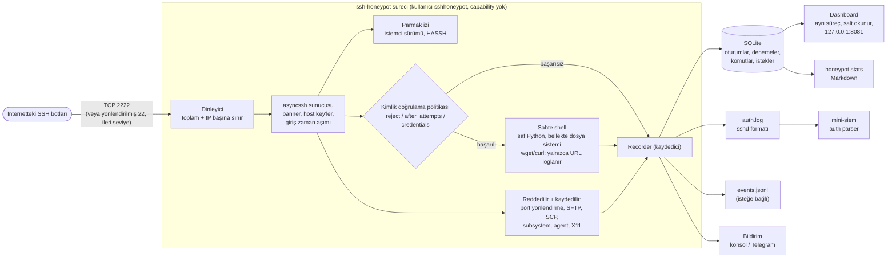

# ssh-honeypot

🇬🇧 [English](README.md)

[](https://github.com/rosko35/ssh-honeypot/actions/workflows/ci.yml)


Düşük etkileşimli (low-interaction) bir SSH honeypot'u. Boştaki bir portu
dinler, sıradan bir Ubuntu OpenSSH sunucusu gibi görünür ve internet
genelinde tarama yapan SSH botlarının ne yaptığını kaydeder: denedikleri her
kullanıcı adı ve parola, sundukları public key'ler, istemci sürümleri ve
HASSH parmak izleri ve - "giriş yapmalarına" izin verirsen - **tamamen
simüle edilmiş** bir shell'e yazdıkları her komut. Veriler SQLite'a,
sshd tarzı bir `auth.log` dosyasına ([mini-siem](https://github.com/rosko35/mini-siem)
bu dosyayı takip edebilir) ve isteğe bağlı olarak JSON-lines formatında bir
loga yazılır. Küçük, salt okunur bir dashboard ve `honeypot stats` komutu
bunları grafiklere ve README tablolarına dönüştürür.

Sunucudaki en az tehlikeli şey olacak şekilde tasarlandı: saldırgan hiçbir
zaman gerçek bir shell'e ulaşmaz, hiçbir şey çalıştırılmaz veya indirilmez,
süreç hiçbir ayrıcalığa sahip değildir ve her bağlantı süre, boyut ve sayı
olarak sınırlıdır.

> **Web siten veya mail sunucunla aynı VPS'te çalıştırmayı mı düşünüyorsun?**
> Önce [Production'ın yanında çalıştırmalı mısın?](#productionın-yanında-çalıştırmalı-mısın)
> bölümünü oku. Kısaca: bunun için tasarlandı, ama ayrı ve ucuz bir VPS yine
> de daha iyi bir seçim.

<!-- DEMO: gerçek bir kayıtla değiştir, ör. docs/demo.gif (dashboard'da tekrar oynatılan bir bot oturumu) -->
> **Demo GIF yer tutucusu** - `docs/demo.gif`: sahte shell'e karşı bir SSH oturumu ve bu oturumun kaydının dashboard'da görünmesi.

<!-- EKRAN GÖRÜNTÜSÜ: docs/dashboard.png ile değiştir -->
> **Ekran görüntüsü yer tutucusu** - `docs/dashboard.png`: zaman içindeki denemeler, en çok denenen kimlik bilgileri, kaynaklar ve bir oturum kaydı içeren dashboard.

<!-- EKRAN GÖRÜNTÜSÜ: docs/telegram.png ile değiştir -->
> **Ekran görüntüsü yer tutucusu** - `docs/telegram.png`: sahte shell'e ulaşan bir oturum için gelen Telegram bildirimi.

---

## Özellikler

- **Gerçekçi bir SSH ön kapısı** - [asyncssh](https://asyncssh.readthedocs.io/)
  tabanlı, ayarlanabilir bir OpenSSH banner'ı (varsayılan:
  `SSH-2.0-OpenSSH_9.6p1 Ubuntu-3ubuntu13.5`) ve ilk açılışta üretilip
  saklanan kalıcı ed25519 / ECDSA / RSA host key'leri olan bir sunucu.
- **Her denemeyi kaydeder** - zaman damgası, kaynak IP ve port, kullanıcı
  adı, parola, sunulan public key'in türü ve SHA256 parmak izi, istemci sürüm
  metni, anlaşılan anahtar değişimi (kex) ve şifreleme algoritması ile
  istemcinin algoritma listelerinden hesaplanan
  [HASSH](https://github.com/salesforce/hassh) parmak izi.
- **Üç kimlik doğrulama politikası** - `reject` (varsayılan: yalnızca kimlik
  bilgisi toplama), `after_attempts` (bir IP'den gelen N'inci parola
  "doğru" kabul edilir) ve `credentials` (zayıf kullanıcı adı/parola
  çiftlerinden oluşan bir liste, `*` joker karakteri desteklenir).
- **Sahte shell** - Ubuntu 24.04 kutusunun saf Python ile, tamamen bellekte
  yapılmış bir taklidi: `uname`, `id`, `ls`, `cat`, `cd`, `ps`, `w`, `free`,
  `df`, `grep | head | wc | awk` boru hatları, bellekteki bir dosya sistemine
  yönlendirmeler (`echo key >> ~/.ssh/authorized_keys` çalışır ve kaydedilir),
  `sh -c`, busybox applet denemeleri. Bilinmeyen komutlar `command not found`
  yazar. `wget`, `curl` ve `tftp` **yalnızca URL'yi loglar** ve bir DNS
  çözümleme hatası basar.
- **Oturumu kaydeder** - her komut satırını bağlantının başlangıcından
  itibaren geçen süreyle birlikte, exec isteklerini ve reddedilen port
  yönlendirme, SFTP, subsystem, agent ve X11 isteklerini.
- **Tasarım gereği sınırlı** - toplam ve IP başına eşzamanlı bağlantı
  sınırı, giriş zaman aşımı, boşta kalma zaman aşımı, azami oturum süresi ve
  bağlantı başına azami girdi baytı, komut sayısı, kanal sayısı, satır
  uzunluğu ve gönderilmeyi bekleyen çıktı miktarı.
- **Depolama**: SQLite (WAL), ayrı bir hostname ile sshd uyumlu bir
  `auth.log` ve isteğe bağlı JSON-lines olay logu. İki metin logu da boyuta
  göre kendini döndürür (rotate).
- **`honeypot stats`** README'ye hazır Markdown üretir: toplamlar, en çok
  denenen kullanıcı adları, parolalar ve çiftler, maskelenmiş kaynak ağlar,
  ülkeler (GeoIP veritabanı varsa), istemci sürümleri, HASSH ve en sık ilk
  komutlar.
- **Dashboard** (FastAPI + Chart.js): zaman içindeki denemeler, en çok
  denenen kimlik bilgileri, kaynaklar, ülkeler, istemci sürümleri, indirme
  URL'leri ve son oturumların komut kayıtları. Salt okunur, yalnızca
  `127.0.0.1`, isteğe bağlı basic auth, Subresource Integrity içeren sıkı bir
  CSP.
- **Telegram bildirimi** (isteğe bağlı, toplu gönderim ve hız sınırlı): bir
  oturum sahte shell'e ulaştığında.
- **Kurulum** - mini-siem ile aynı tarzda sıkılaştırılmış systemd unit'leri
  ve kurulum scripti ya da salt okunur, capability'siz bir container ile
  Docker.

## Mimari



İnternete açık süreç hiçbir web sunucusu içermez; dashboard veritabanını
salt okunur açan ayrı bir süreçtir. Saldırganın etkileyebildiği her şey tek
yönde akar: soketten kaydediciye.

## Hızlı başlangıç (yerel, yalnızca loopback)

```bash
python -m venv .venv && source .venv/bin/activate     # Windows: .venv\Scripts\activate
pip install -e ".[dev]"

honeypot run                    # 127.0.0.1:2222, politika "reject"
```

Başka bir terminalde:

```bash
ssh -p 2222 -o StrictHostKeyChecking=no -o UserKnownHostsFile=/dev/null root@127.0.0.1
# her parola başarısız olur - ve kaydedilir

honeypot stats --days 1 --min-sources 1     # Markdown özeti
honeypot dashboard                          # http://127.0.0.1:8081
```

Sahte shell'i denemek için config'i kopyala ve politikayı değiştir:

```bash
cp config.yml config.local.yml
# config.local.yml içinde:  auth: {policy: after_attempts, accept_after: 2}
honeypot -c config.local.yml run
```

Projeyle gelen `config.yml` bilerek `127.0.0.1` adresini dinler: projeyi
klonlayıp çalıştırmak hiçbir şeyi dışarı açmaz. Kurulum scripti ve Docker
imajı, gerçek kurulum için bunu tüm arayüzlere çevirir.

## Bir sunucuda çalıştırmak

Adım adım rehber (systemd veya Docker), portu dışarı açmanın iki yolu ve
riskleri, isteğe bağlı çıkış (egress) güvenlik duvarı kuralı ve mini-siem
bağlantısı için **[DEPLOY.tr.md](DEPLOY.tr.md)** dosyasına bak. Kısaca:

```bash
git clone https://github.com/rosko35/ssh-honeypot.git && cd ssh-honeypot
sudo ./deploy/install.sh            # kurar, başlatmaz
sudo systemctl enable --now ssh-honeypot
sudo ufw allow 2222/tcp             # senin kararın, DEPLOY.tr.md'ye bak
```

## Kimlik doğrulama politikaları

| `auth.policy` | Ne olur | Ne için kullanılır |
|---|---|---|
| `reject` (varsayılan) | her parola ve key başarısız olur | kimlik bilgisi istatistikleri; en küçük saldırı yüzeyi |
| `after_attempts` | bir IP'den gelen `accept_after`'ıncı parola denemesi başarılı olur (bağlantılar arasında, bellekte sayılır); aynı kimlik bilgileri o IP için çalışmaya devam eder | botların "başarılı" bir brute force sonrası ne yaptığını görmek |
| `credentials` | yalnızca listelenen çiftler başarılı olur, `*` her şeyle eşleşir | klasik zayıf parola tuzağı (`root` / `123456`) |

Public key'ler hiçbir zaman kabul edilmez, yalnızca kaydedilir.
`auth.valid_users` içinde olmayan kullanıcı adları, gerçek bir sunucuda
olduğu gibi auth logunda sshd'nin `Invalid user` satırını alır.
`max_attempts_per_connection` kadar başarısız denemeden sonra bağlantı
kesilir ve her başarısız deneme, sshd'de olduğu gibi `failure_delay` saniye
sonra cevaplanır.

## Neler kaydedilir

| Tablo | Her satır | Başlıca sütunlar |
|---|---|---|
| `sessions` | bir TCP bağlantısı | başlangıç/bitiş, kaynak IP/port, ülke, istemci sürümü, HASSH + algoritma listeleri, kex, cipher, MAC, deneme sayısı, giriş kullanıcısı/parolası, terminal türü, komut sayısı, gelen bayt, bitiş nedeni |
| `auth_attempts` | bir parola veya key denemesi | kullanıcı adı, yöntem, parola, key türü + SHA256 parmak izi, başarı |
| `commands` | bir komut satırı (shell veya exec) | zaman, bağlantıdan bu yana geçen saniye, metin, içindeki her komutun bilinip bilinmediği |
| `requests` | bir yan istek | exec, `direct-tcpip`, `tcpip-forward`, streamlocal, tun/tap, subsystem (ör. `sftp`); ayrıntı ve kabul bilgisiyle |
| `downloads` | wget/curl/tftp'ye verilen bir URL | araç, URL (asla indirilmez) |

Bitiş nedenleri bir bağlantının nasıl sona erdiğini söyler: `client closed`,
`idle timeout`, `max duration`, `input limit`, `command limit`,
`request limit`, `too many auth attempts`, `output backlog` veya `shutdown`.

## Sahte shell ve güvenlik modeli

Honeypot'un en önemli özelliği **yapmadıklarıdır**:

- Host üzerinde **asla hiçbir şey çalıştırmaz**. `subprocess` yok, PTY yok,
  gerçek shell yok. Her komut, bir metin döndüren bir Python fonksiyonudur.
- Saldırgan girdisi için **gerçek dosya sistemine asla dokunmaz**. Sahte
  dosya sistemi sabitlerden oluşturulan ve her bağlantı için kopyalanan bir
  sözlüktür (dictionary); bayt ve kayıt bütçesi vardır (256 KB / 256 öğe).
- Saldırgan adına **asla dışarıya bağlantı açmaz**. `wget`, `curl` ve
  `tftp` URL'yi kaydeder ve inandırıcı bir hata basar. Port yönlendirme,
  SFTP, SCP, subsystem'ler, agent ve X11 yönlendirme reddedilir. Ters DNS
  (reverse DNS) ve GSSAPI kapalıdır; yani gelen bir bağlantı hiçbir zaman
  dışarıya bir DNS sorgusu yapılmasına yol açmaz.
- `grep` yalnızca sabit metin arar; böylece saldırgan honeypot'a felaket
  derecede yavaş bir düzenli ifade (regex) veremez.
- Her bağlantı sınırlıdır (varsayılanlar): toplamda 100 bağlantı, IP başına
  5, kimlik doğrulama için 30 sn, 120 sn boşta kalma, en fazla 600 sn, 64 KB
  girdi, 200 komut, 4 kanal, 4096 karakterlik satırlar, 256 KB gönderilmemiş
  çıktı, 100 kayıtlı yan istek. Sınırı aşan bağlantılar daha hiçbir veri
  saklanmadan düşürülür; böylece bir saldırı seli veritabanını büyütemez.

Bu özellikler yalnızca vaat edilmiyor, test ediliyor: `tests/test_server.py`
honeypot'u gerçek bir SSH istemcisiyle kullanır ve istemci `wget`,
`curl | sh` ve port yönlendirme denerken **sıfır** bağlantı alması gereken
bir TCP dinleyicisi çalıştırır; `tests/test_safety.py` saldırgana açık
modüllerin kaynak kodunu ayrıştırır ve `subprocess`, `socket`, `os`,
`pathlib` gibi modülleri import ederlerse, `open()` çağırırlarsa ya da
asyncssh'in yönlendirme, SCP, SFTP ve ters DNS ayarları değişirse testi
başarısız yapar.

## mini-siem ile birlikte kullanmak

[mini-siem](https://github.com/rosko35/mini-siem), aynı tür sunucu için
yazdığım log tabanlı saldırı tespit sistemi. Honeypot,
`/var/log/ssh-honeypot/auth.log` dosyasını tam olarak sshd'nin kullandığı
formatta yazar:

```text
2026-11-19T10:15:01.123456+00:00 honeypot sshd[48213]: Invalid user admin from 198.51.100.7 port 50022
2026-11-19T10:15:01.130211+00:00 honeypot sshd[48213]: Failed password for invalid user admin from 198.51.100.7 port 50022 ssh2
2026-11-19T10:15:04.002871+00:00 honeypot sshd[48214]: Accepted password for root from 203.0.113.9 port 41234 ssh2
```

Bu yüzden mini-siem'in mevcut `auth` parser'ı dosyayı değişiklik yapmadan
okur (bir test, honeypot'un kendi çıktısını mini-siem'in gerçek parser'ından
geçirir). Hostname `honeypot`'tur (`log_hostname` ile değiştirilebilir);
böylece olaylar gerçek sshd'den ayırt edilebilir. Parolalar, tıpkı sshd'de
olduğu gibi, bu loga asla yazılmaz. Kullanıcı adları kaçışlanır (escape;
boşluk için `\x20`, satır sonu için `\x0a`); böylece
`x from 192.0.2.66 port 1` gibi bir kullanıcı adı, bir parser'ın başka bir
IP'yi suçlamasına ya da sahte bir satır üretilmesine yol açamaz.

mini-siem'in `config.yml` dosyasına bir kaynak daha olarak ekle:

```yaml
sources:
  - type: file
    path: /var/log/ssh-honeypot/auth.log
    parser: auth
```

ve mini-siem'e okuma izni ver (`sudo usermod -aG sshhoneypot minisiem`, sonra
mini-siem'i yeniden başlat). Honeypot'a gelen denemelerin gerçek
`ssh-bruteforce` alarmlarını tetiklememesi dahil ayrıntılar DEPLOY.tr.md'de.

## Yapılandırma

`config.yml` davranışı, ortam değişkenleri (veya `.env`) gizli bilgileri
tutar.

| Anahtar | Varsayılan | Anlamı |
|---|---|---|
| `listen.host` / `listen.port` | `127.0.0.1` / `2222` | `HONEYPOT_LISTEN_HOST/PORT` ile ezilebilir; `0.0.0.0` = tüm IPv4, `""` = tüm IPv4 + IPv6 |
| `banner` | `OpenSSH_9.6p1 Ubuntu-3ubuntu13.5` | `SSH-2.0-` sonrasındaki kısım |
| `hostname` | `web-prod-01` | sahte shell içindeki hostname |
| `host_key_types` | ed25519, ecdsa, rsa | ilk açılışta `state_dir` içine üretilir |
| `database` / `state_dir` | `data/honeypot.db` / `data` | `HONEYPOT_DB` / `HONEYPOT_STATE_DIR` ile ezilebilir |
| `auth_log` | `data/auth.log` | sshd tarzı log; `null` kapatır (`HONEYPOT_AUTH_LOG`) |
| `auth_log_timestamps` | `rfc3339` | ya da `classic` (`Nov 19 10:15:01`) |
| `log_hostname` | `honeypot` | auth.log satırlarındaki hostname |
| `json_log` | `null` | JSON-lines olay logunun yolu (`HONEYPOT_JSON_LOG`) |
| `retention_days` | `90` | bundan eski oturumlar saatte bir silinir |
| `auth.policy` | `reject` | `reject`, `after_attempts`, `credentials` |
| `auth.accept_after` | `3` | `after_attempts` için |
| `auth.credentials` | `[]` | `credentials` için: `{username, password}` çiftleri, `*` = herhangi biri |
| `auth.valid_users` | `[root, ubuntu]` | diğerleri `Invalid user` olarak loglanır |
| `auth.max_attempts_per_connection` | `6` | sonra bağlantı kesilir |
| `auth.failure_delay` | `1.0` | başarısız deneme cevaplanmadan önce beklenen saniye |
| `limits.*` | yukarıya bak | bağlantılar, zaman aşımları, girdi, komutlar, kanallar, satır uzunluğu |
| `geoip.database` | `null` | isteğe bağlı `.mmdb` dosyası |
| `dashboard.host/port` | `127.0.0.1:8081` | `HONEYPOT_DASHBOARD_HOST/PORT` ile ezilebilir |
| `telegram.batch_interval` | `60` | saniye; her aralıkta en fazla bir mesaj |

| Ortam değişkeni | Amacı |
|---|---|
| `TELEGRAM_BOT_TOKEN`, `TELEGRAM_CHAT_ID` | Telegram bildirimlerini açar |
| `HONEYPOT_NAME` | Telegram mesajlarında görünen ad |
| `HONEYPOT_DASHBOARD_USER`, `HONEYPOT_DASHBOARD_PASSWORD` | dashboard için HTTP basic auth |

## Dashboard ve API

Dashboard, her 30 saniyede bir salt okunur bir JSON API'sini sorgulayan tek
bir statik sayfadır. Veritabanındaki her metin bir saldırgan tarafından
yazılmıştır; bu yüzden API yalnızca JSON döndürür, sayfa DOM öğelerini
yalnızca `textContent` ile oluşturur (bir test, `innerHTML` ve benzerlerinin
hiç kullanılmadığını kontrol eder) ve sunucu sıkı bir Content-Security-Policy
gönderir: satır içi (inline) script veya stil yok; script'ler yalnızca
sunucunun kendisinden ve SRI hash'i ile sabitlenmiş Chart.js'ten yüklenir.

| Endpoint | Döndürdüğü |
|---|---|
| `GET /api/summary?days=7` | bağlantılar, IP'ler, denemeler, farklı kullanıcı adı/parola sayısı, shell oturumları, komutlar, URL'ler |
| `GET /api/timeline?hours=48` | saat başına denemeler, bağlantılar ve shell girişleri |
| `GET /api/top-usernames`, `/top-passwords`, `/top-pairs` | en çok denenen kimlik bilgileri (`days`, `limit`) |
| `GET /api/top-ips`, `/countries`, `/client-versions` | kaynaklar ve istemciler |
| `GET /api/downloads` | wget/curl/tftp'ye verilen URL'ler |
| `GET /api/sessions/recent?shell_only=true` | son oturumlar |
| `GET /api/sessions/{id}` | tek bir oturum: kimlik doğrulama denemeleri, komut kaydı, istekler, indirmeler |
| `GET /healthz` | canlılık kontrolü (kimlik doğrulamasız) |

## CLI

```text
honeypot run            SSH honeypot'unu çalıştırır (servisin çalıştırdığı komut)
honeypot dashboard      salt okunur dashboard'u sunar
honeypot stats          --days 30 [--limit 10] [--full-ips] [--min-sources 2]
honeypot prune          [--days N]     saklama süresini (retention) hemen uygular
honeypot check-config   yapılandırmayı doğrular
```

Genel seçenekler: `-c/--config DOSYA` (veya `HONEYPOT_CONFIG`), `-v/--verbose`.

## GeoIP

Hiçbir veritabanı projeyle gelmez veya otomatik indirilmez. Veritabanı
yoksa ülkeler "unknown" (bilinmiyor) görünür ve `honeypot stats` ülke
tablosunu hiç göstermez. Ücretsiz seçenekler: MaxMind GeoLite2 Country
(ücretsiz hesap ve lisans anahtarı gerekir; EULA gereği güncel tutulmalı,
`geoipupdate` yardımcı olur) veya DB-IP "IP to Country Lite" (CC BY 4.0;
sonuçları yayınlarsan kaynak gösterilmesi gerekir). `geoip.database`
ayarını `.mmdb` dosyasına yönlendir. Sorgular yerel dosya okumalarıdır.

## Gerçek dünya sonuçları

> **Yer tutucu - henüz gerçek veri yok.** Bu bölüm, honeypot gerçek bir
> sunucuda bir ay çalıştıktan sonra `honeypot stats --days 30` çıktısıyla
> doldurulacak. Aşağıdaki her değer bir yer tutucudur, ölçüm değildir.

<!-- BAŞLANGIÇ: `honeypot stats --days 30` çıktısını buraya yapıştır -->

| Metrik | Değer |
|---|---:|
| Bağlantılar | `<TODO: honeypot stats'tan>` |
| Farklı kaynak IP adresleri | `<TODO>` |
| Giriş denemeleri | `<TODO>` |
| Günlük ortalama giriş denemesi | `<TODO>` |
| Farklı kullanıcı adları | `<TODO>` |
| Farklı parolalar | `<TODO>` |
| Sahte shell'e ulaşan oturumlar | `<TODO>` |
| Kaydedilen komutlar | `<TODO>` |

**En çok denenen kullanıcı adları:** `<TODO: honeypot stats tablosu>`

**En çok denenen parolalar:** `<TODO: honeypot stats tablosu>`

**En çok denenen kullanıcı adı:parola çiftleri:** `<TODO: honeypot stats tablosu>`

**En çok görülen kaynak ağlar / ülkeler:** `<TODO: honeypot stats tabloları>`

**En çok görülen istemci sürümleri / HASSH:** `<TODO: honeypot stats tabloları>`

**En sık ilk komutlar:** `<TODO: honeypot stats tablosu>`

<!-- BİTİŞ -->

**Gözlemler:** `<TODO: bir ay sonra dikkatimi çekenler; ör. yeni bir IP'nin
ne kadar çabuk bulunduğu, hangi araçların göründüğü, ilk komutların neyi
öğrenmeye çalıştığı>`

## Production'ın yanında çalıştırmalı mısın?

Bunu, aynı zamanda bir web sitesi ve mail sunan küçük bir VPS'te çalışsın
diye yazdım; bu yüzden izolasyon tasarımdaki ana kısıttı. Bunun sana neler
kazandırdığını ve neleri kazandırmadığını dürüstçe anlatıyorum.

**Tasarımın garanti ettikleri**

- "Giriş yapan" bir saldırgan bir shell ile değil, bir Python fonksiyonuyla
  konuşur. Hiçbir komut çalıştırılmaz, onun adına host üzerindeki hiçbir
  dosya okunmaz veya yazılmaz, hiçbir şey indirilmez ve onun için hiçbir
  bağlantı açılmaz. Bunlar testlerle kontrol edilen kod özellikleridir.
- Servis, **hiçbir capability'si olmayan** (22 numaralı portu bile
  dinleyemez) ayrı bir sistem kullanıcısıyla çalışır; `NoNewPrivileges`,
  `ProtectSystem=strict`, özel bir `/tmp`, home dizinlerine erişimsizlik
  vardır ve yalnızca TCP 2222 portunu dinleyebilir. Web kök dizinleri, TLS
  anahtarları, mail kutuları ve ayarları, veritabanı dizinleri ve gerçek
  sshd yapılandırması ona **görünmez** yapılır (`InaccessiblePaths=`). Docker
  sürümü tüm capability'leri düşürür ve salt okunur bir kök dosya sistemi
  kullanır.
- CPU (%25), bellek (256 MB), görev (task) ve bağlantı sınırları bir saldırı
  selinin web sitesini kaynaksız bırakmasını engeller.

**Garanti edemedikleri**

- **Honeypot, saldırgana dönük bir koddur.** Kimlik doğrulamadan önce
  asyncssh, `cryptography` paketi ve OpenSSL, yabancıların seçtiği baytları
  ayrıştırır. Bunlarda (ya da benim kodumda) bir hata, saldırgana
  *sandbox içinde, `sshhoneypot` kullanıcısı olarak* kod çalıştırma imkânı
  verebilir. Sandbox sonrasında yapabileceklerini sınırlar, ama production
  servislerinle aynı çekirdeği (kernel) paylaşır: bir çekirdek yetki
  yükseltme açığı bu çizgiyi aşabilir. Sunucuyu güncel tut
  (`unattended-upgrades`) ve güncellemelerden sonra kurulum scriptini yeniden
  çalıştır.
- **IP adresine dikkat çeker.** 2222'de bir SSH servisi bulan tarayıcılar
  geri gelir; honeypot tespit servisleri IP'yi etiketleyebilir. Web siten ve
  mail sunucun bu IP'yi ve onun kötüye kullanım listelerindeki itibarını
  paylaşır (honeypot kendisi hiçbir şey göndermez, bu yüzden seni bir listeye
  sokmaması gerekir; ama sunucuyu daha ilgi çekici yapar).
- **Saldırı selleri host'a yine de bir maliyet getirir.** Bağlantı sınırları,
  çekirdek TCP bağlantısını kabul ettikten sonra uygulanır: bant genişliği,
  bağlantı takip tablosu (conntrack) ve dinleme kuyruğu production ile
  paylaşılır. Gerçek bir DDoS, internete açık her servis için bir sorundur.
- **Disk.** Metin logları kendini döndürür, ama veritabanı trafikle birlikte
  `retention_days` onu temizleyene kadar büyür. İlk haftalarda göz kulak ol.
- **22 numaralı portu açmak** (DEPLOY.tr.md'deki (b) seçeneği), gerçek
  sshd'ni taşımak demektir - orada tek bir yazım hatası ve kendi sunucunun
  dışında kalırsın.
- **Tespit edilebilir.** Dikkatli bir insan bunun bir honeypot olduğunu
  fark eder. Botlar hakkında istatistik için bu sorun değil; bu bir
  aldatma (deception) platformu değil.

**Önerim:** ayda birkaç euro harcayabiliyorsan, önemsediğin hiçbir şeyi
barındırmayan **ayrı, gözden çıkarılabilir bir VPS**'te çalıştır ve veriyi
veya auth logunu ana makinene gönder. Production'ın yanında çalıştıracaksan
varsayılan `reject` politikasını koru (sahte shell'e hiç ulaşılmaz, bu yüzden
en az kod dışarıya açık kalır), (a) seçeneğini - yalnızca 2222 portunu -
kullan ve DEPLOY.tr.md'deki isteğe bağlı çıkış güvenlik duvarı kuralını
düşün.

### Hukuki notlar ve gizlilik

Bu bir hukuki tavsiye değildir; sana uygulanan kuralları ve hosting
sağlayıcının kullanım şartlarını kontrol et (bazı sağlayıcılar honeypot'ları
kısıtlar veya kötüye kullanım bildirimleriyle ilgilenmeni ister).

- **IP adresleri ve yazılan kimlik bilgileri**, bir botnet'ten gelseler bile
  birçok hukuk düzeninde **kişisel veridir** (örneğin GDPR ve KVKK
  kapsamında). Bir amacın olsun (güvenlik araştırması, servisini korumak),
  veriyi gerektiğinden uzun tutma (`retention_days`, varsayılan 90;
  `honeypot prune --days N` hemen uygular) ve erişimi kısıtla (kurulum
  scripti state, log ve config dizinlerini yalnızca root ve servis
  kullanıcısı tarafından okunabilir yapar).
- **Saldırganlar bazen gerçek kimlik bilgileri yazar** - kendilerininkini ya
  da başka bir yerden çalınmış olanları - ve gerçek insanlar parolalarını
  yanlışlıkla yanlış sunucuya yazar. Veritabanını hassas veri olarak gör.
  Yakalanan kimlik bilgilerini asla bir yerde deneme: bu yetkisiz erişim
  olur. `honeypot stats` IP adreslerini maskeler ve varsayılan olarak
  yalnızca en az iki farklı kaynak IP'den denenmiş parolaları listeler;
  böylece tek seferlik gerçek bir parola yanlışlıkla yayınlanmaz.
- **URL'ler kaydedilir, asla indirilmez.** Bir zararlı yazılımı incelemek
  istiyorsan, bunu bu sunucuda değil, zararlı yazılım analizi için kurulmuş
  izole bir ortamda yap.
- Telegram mesajları kaynak IP'yi ve kullanıcı adını içerir (parolayı
  içermez).

## Sınırlamalar

- Tasarım gereği düşük etkileşimli: gerçek komut anlamları, komut yerine
  koyma (command substitution) veya glob yok, stdin etkileşimi yok, sabit
  bir sahte dosya sistemi var. Dikkatli kontrol eden botlar fark eder.
- Yalnızca SSH. Telnet veya başka protokol yok.
- asyncssh parolaları SASLprep ile normalleştirir ve geçerli UTF-8 olmayan
  ya da yasaklı karakterler içeren bir parola geldiğinde bağlantıyı keser;
  bu yüzden bu tür denemeler kaydedilmez ve kaydedilen parolalar
  normalleştirilmiş haldedir.
- HASSH ve anlaşılan algoritmalar asyncssh'in özel (private) alanlarından
  okunur; bir asyncssh güncellemesi bunları bozabilir (o zaman boş kalırlar
  ve bir test başarısız olur).
- Tek süreç, tek host, yalnızca SQLite.
- Dashboard, Chart.js'i jsDelivr'den yükler (SRI ile sabitlenmiş);
  tarayıcının internet erişimi yoksa grafikler boş kalır, tablolar yine
  çalışır.

## Neden yaptım / neler öğrendim

mini-siem'i yazdıktan sonra sunucuma yapılan brute force denemelerini
görebiliyordum, ama yalnızca kullanıcı adlarını: sshd parolaları loglamaz ve
bir saldırganın içeri girdikten *sonra* ne yapacağı hakkında hiçbir şey
söylemez. Resmin bu ikinci yarısını, web sitemi barındıran bir makinede
kimseye gerçek bir shell vermeden görmek istedim. Cevap düşük etkileşimli bir
honeypot'tu ve onu kendim yazmak, hem SSH'ı hem de botları anlamanın
bulabildiğim en iyi yoluydu.

Yol boyunca öğrendiklerim:

- **SSH, parolalardan ibaret değil.** Protokolü sunucu tarafından izlemek
  (KEXINIT, kimlik doğrulama yöntemleri, kanal ve global istekler) bana bir
  istemcinin daha kimlik doğrulamadan ne kadar çok şey ele verdiğini
  öğretti. HASSH parmak izleri, sürüm metni yalan söylese bile aracı ortaya
  çıkarır. asyncssh istemcinin KEXINIT'ini dışarıya açmıyor; bu yüzden onu
  özel bir alandan okudum ve bir güncelleme bunu değiştirirse yüksek sesle
  başarısız olan bir test yazdım.
- **Loglar da bir saldırı yüzeyidir.** İlk auth.log yazıcım kullanıcı adını,
  sshd'nin yaptığı gibi satıra olduğu gibi kopyalıyordu. Bu durumda
  `x from 192.0.2.66 port 1` gibi bir kullanıcı adı, regex tabanlı bir
  parser'ın (benim mini-siem'im dahil) yanlış IP'yi suçlamasına, bir satır
  sonu da sahte bir satır üretilmesine yol açardı. Artık yazdırılabilir
  ASCII dışındaki her bayt, boşluk dahil, kaçışlanıyor ve bir test kötü
  niyetli kullanıcı adlarını mini-siem'in gerçek parser'ından geçiriyor.
- **"Asla bir şey çalıştırma" baştan tasarlanmalı.** Sahte shell yalnızca
  metin işleme, ama metin işlemenin de tuzakları var: saldırganın regex'iyle
  çalışan bir `grep` süreci kilitleyebilir (bu yüzden yalnızca sabit metin
  arıyor), `sh -c` kendini tekrar tekrar çağırabilir (bu yüzden derinlik
  sınırlı), istemci okumayı bıraktığında çıktı birikebilir (bu yüzden bir
  birikme sınırı var). İstemci `wget` ve port yönlendirme denerken sessiz
  kalması gereken bir TCP dinleyicisiyle yazılmış bir test, kendi kodumu
  tekrar okumaktan çok daha ikna ediciydi.
- **Her kaynağın bir sınırı olmalı.** Bağlantılar, süre, baytlar, komutlar,
  kanallar, yan istekler, bağlantı başına satır sayısı, log boyutu. Unuttuğum
  her biri, honeypot'a bedavaya iş yaptırmanın bir yolu olarak karşıma
  çıktı.
- **systemd sandbox'ı güçlü.** `SocketBindAllow=`, production gizli
  bilgileri için `InaccessiblePaths=` ve dashboard için `IPAddressDeny=`,
  "umarım kod doğrudur" düşüncesini "doğru olmasa bile pek bir şey
  yapamaz"a dönüştürüyor. systemd'nin neyi yapamadığını da öğrendim:
  "herkesten bağlantı kabul et ama asla dışarı bağlanma" diyemiyor; bu
  yüzden çıkış filtrelemesi, belgelenmiş bir güvenlik duvarı kuralı olarak
  kaldı.
- **Gizlilik tasarımın bir parçası.** Parolalarla ilgili istatistik
  yayınlamak, gerçek bir insanın gerçek bir parolayı yanlış sunucuya
  yazmış olabileceğini fark edene kadar zararsız görünüyor. IP'leri
  maskelemek ve yalnızca birden fazla kaynaktan görülen parolaları
  listelemek bilinçli tercihlerdi.

## Geliştirme

```bash
pip install -e ".[dev]"
pip install --no-deps -e ../mini-siem      # isteğe bağlı: auth.log uyumluluk testlerini açar
ruff check . && ruff format --check .
pytest
```

Test paketi honeypot'u `127.0.0.1` üzerinde geçici (ephemeral) bir portta
başlatır ve onu istemci olarak asyncssh ile kullanır: her politikada
reddedilen ve kabul edilen girişler, public key denemeleri, etkileşimli sahte
shell, exec istekleri, hiçbir yere bağlanmaması gereken `wget` ve `curl`,
reddedilen yönlendirme ve SFTP ve her sınır (komutlar, girdi baytları, satır
uzunluğu, boşta kalma zaman aşımı, azami süre, giriş zaman aşımı, bağlantı
sınırları, kanal sınırı, istek seli). Ayrıca sahte shell'i tek başına,
depolama sorgularını ve saklama süresini, kötü niyetli değerler içeren
Markdown istatistiklerini, auth.log'un mini-siem parser'ıyla uyumunu,
kötü niyetli girdinin HTML olarak işlenmemesi ve kimlik doğrulama dahil
dashboard API'sini ve sahte (mock) bir Bot API'sine karşı Telegram
bildiricisini kapsar. GitHub Actions, her push'ta Python 3.11-3.13 üzerinde
ruff ve pytest'i, kurulum scripti için de shellcheck'i çalıştırır.

Proje yapısı:

```text
src/sshhoneypot/
  server.py       asyncssh sunucusu, kimlik doğrulama politikası, sınırlar, reddedilen istekler
  shell/          sahte shell: parser, simüle komutlar, bellekte dosya sistemi
  fingerprint.py  HASSH ve anlaşılan algoritmalar
  recorder.py     veritabanına, loglara ve bildiricilere dağıtım
  storage.py      SQLite depolama ve sorgular
  logs.py         sshd tarzı auth.log ve JSON-lines log
  notifiers.py    konsol ve Telegram
  stats.py        honeypot stats
  web/            FastAPI uygulaması ve statik dashboard
  cli.py          komut satırı
deploy/           systemd unit'leri ve kurulum scripti
```

## Lisans

[MIT](LICENSE) © 2026 Emre Özaydın
